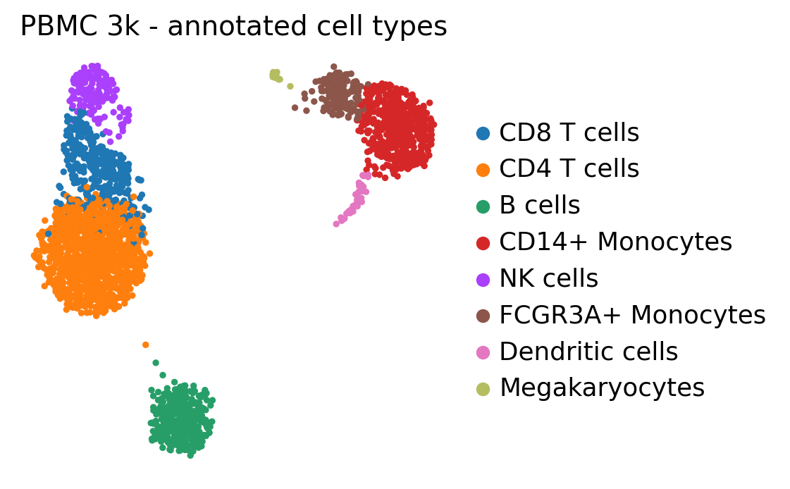

# Single-cell RNA-seq of 2,700 PBMCs

[](https://www.python.org/)
[](https://scanpy.readthedocs.io/)
[](LICENSE)

This was my first single-cell project, done after my [bulk RNA-seq project](https://github.com/IshanMaheshwari01/RNA-seq-differential-expression-analysis). I took the raw count matrix for 2,700 blood cells (PBMCs) from 10x Genomics and, without using any labels, worked out which immune cell types are in there and which genes mark them. PBMC 3k is a well-known dataset from one healthy donor, so it's a good way to check the analysis gives the right answer before using the same steps on data where the answer isn't known.

It follows the standard [Scanpy PBMC 3k tutorial](https://scanpy.readthedocs.io/en/stable/tutorials/basics/clustering-2017.html), but I rewrote it as a small Python package with all settings in one config file, so the whole thing runs with one command. The notebook in [`notebooks/pbmc3k_analysis.ipynb`](notebooks/pbmc3k_analysis.ipynb) walks through each step with the plots, and there is a small interactive version of the results [here](https://ishanmaheshwari01.github.io/single-cell-rnaseq-pbmc3k/docs/).

<p align="center">
  
</p>

## Results

I started with 2,700 cells and 32,738 genes. After QC, 2,638 cells were left, and they split into 8 clusters:

| Cell type | Cells | Markers used |
|---|---:|---|
| CD4 T cells | 1,107 | `IL7R`, `CD3D`, `CCR7` |
| CD14+ monocytes | 486 | `CD14`, `LYZ`, `S100A8/9` |
| CD8 T cells | 341 | `CD8A`, `CD8B`, `GZMK` |
| B cells | 341 | `MS4A1`, `CD79A`, `CD79B` |
| NK cells | 164 | `GNLY`, `NKG7`, `KLRD1` |
| FCGR3A+ monocytes | 150 | `FCGR3A`, `MS4A7` |
| Dendritic cells | 36 | `FCER1A`, `CST3` |
| Megakaryocytes | 13 | `PPBP`, `PF4` |

T cells are the biggest group, which is normal for blood. Even the megakaryocytes, only 13 cells, came out as their own cluster.

## What the pipeline does

Standard Scanpy workflow, one function per step in [`src/pipeline.py`](src/pipeline.py):

1. **QC** - filter barcodes with too few or too many genes (droplets and doublets) and cells with more than 5% mitochondrial counts. Left 2,638 of 2,700 cells.
2. **Normalisation** - scale each cell to 10,000 counts, then `log(1+x)`.
3. **Highly variable genes** - keep the 1,838 genes that vary the most across cells.
4. **Scaling and PCA** - regress out depth and mitochondrial fraction, scale, top 40 PCs.
5. **Neighbours, UMAP, Leiden** - kNN graph, UMAP for viewing, Leiden for the clusters (8 found).
6. **Marker genes** - one-vs-rest Wilcoxon test per cluster.
7. **Annotation** - score every cluster against known marker lists and take the best match, instead of hard-coding "cluster 3 = CD8 T cells". The labels still come out right if a different Scanpy version numbers the clusters differently.

All thresholds live in `src/config.py`, and one seed (`RANDOM_SEED = 0`) is used for PCA, the neighbour graph, UMAP and Leiden. Package versions I used: scanpy 1.12.1, anndata 0.12.16, numpy 2.4.4, scipy 1.17.1, scikit-learn 1.8.0, leidenalg 0.12.0, python-igraph 1.0.0, umap-learn 0.5.12, numba 0.65.1.

## Running it

Tested on Ubuntu. The data is about 30 MB and the full run takes around 50 seconds on a laptop.

```bash
git clone https://github.com/IshanMaheshwari01/single-cell-rnaseq-pbmc3k.git
cd single-cell-rnaseq-pbmc3k

python3 -m venv .venv && source .venv/bin/activate
pip install -r requirements.txt
# or: conda env create -f environment.yml && conda activate scrnaseq-pbmc3k

bash data/download_data.sh
python -m src.run_pipeline          # writes figures/ and results/
jupyter lab notebooks/pbmc3k_analysis.ipynb
```

Or with the Makefile: `make setup`, `make data`, `make run`, `make notebook`.

Outputs: `results/marker_genes.csv` (top 25 markers per cluster), `results/cluster_celltype_mapping.csv` (score for every cluster and cell type pair), `results/celltype_counts.csv` (cells per type), and `pbmc3k_processed.h5ad` (not committed, `make run` recreates it). All plots are in `figures/`.

## What I'd add next

- Doublet detection with [Scrublet](https://github.com/swolock/scrublet) before clustering
- Cell cycle scoring
- Automatic annotation with [CellTypist](https://www.celltypist.org/) to compare with my manual labels

I later did batch integration (Harmony and scVI) and CellTypist annotation on a much bigger dataset in [sle-pbmc-ml](https://github.com/IshanMaheshwari01/sle-pbmc-ml).

## License

MIT. The PBMC 3k data belongs to 10x Genomics and is used under their [dataset terms](https://www.10xgenomics.com/datasets). Main references: Wolf et al. 2018 (Scanpy, Genome Biology), Traag et al. 2019 (Leiden, Scientific Reports), McInnes et al. 2018 (UMAP, arXiv:1802.03426).
