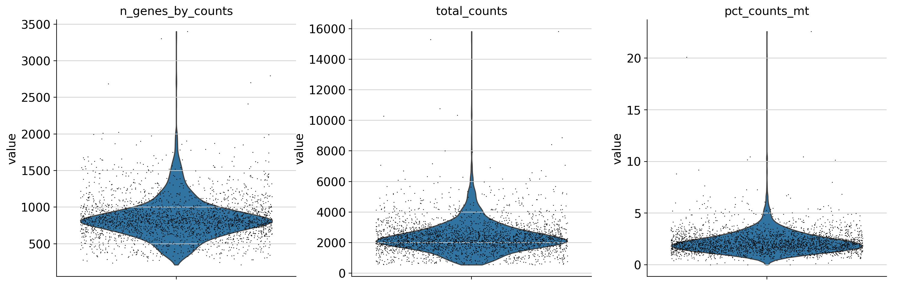
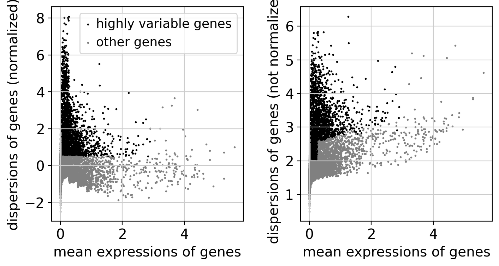
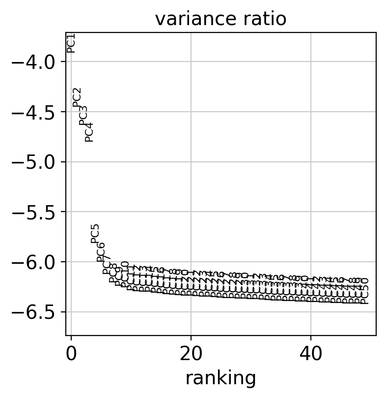
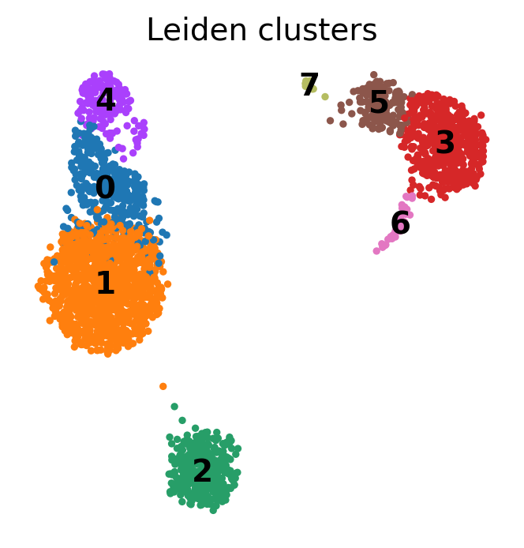
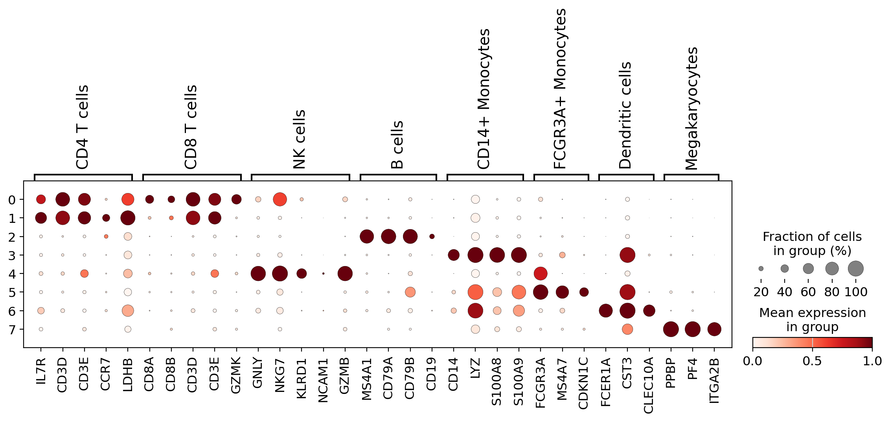
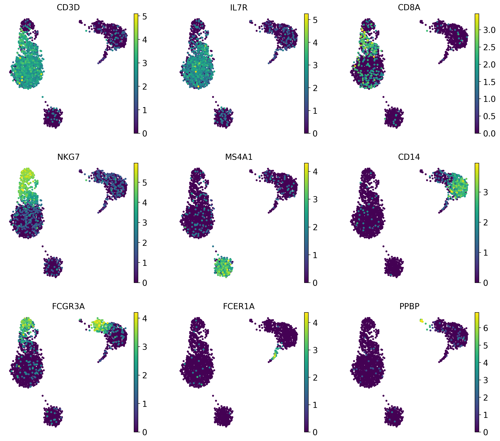
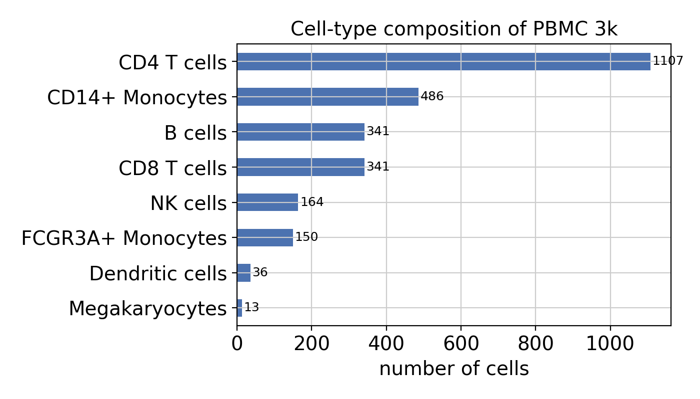

# Single-cell RNA-seq of 2,700 PBMCs

[](https://www.python.org/)
[](https://scanpy.readthedocs.io/)
[](LICENSE)

This was my first single-cell project, done after my [bulk RNA-seq project](https://github.com/IshanMaheshwari01/RNA-seq-differential-expression-analysis). I took the raw count matrix for 2,700 blood cells (PBMCs) from 10x Genomics and, without using any labels, worked out which immune cell types are in there and which genes mark them.

It follows the standard [Scanpy PBMC 3k tutorial](https://scanpy.readthedocs.io/en/stable/tutorials/basics/clustering-2017.html), but I rewrote it as a small Python package with all settings in one config file, so the whole thing runs with one command. The notebook in [`notebooks/pbmc3k_analysis.ipynb`](notebooks/pbmc3k_analysis.ipynb) walks through each step with the plots.

<p align="center">
  
</p>

## Results

I started with 2,700 cells and 32,738 genes. After QC, 2,638 cells were left, and they split into 8 clusters:

| Cell type | Cells | Markers used |
|---|---:|---|
| CD4 T cells | 1,107 | `IL7R`, `CD3D`, `CCR7` |
| CD14+ monocytes | 486 | `CD14`, `LYZ`, `S100A8/9` |
| CD8 T cells | 341 | `CD8A`, `CD8B`, `GZMK` |
| B cells | 341 | `MS4A1`, `CD79A`, `CD79B` |
| NK cells | 164 | `GNLY`, `NKG7`, `KLRD1` |
| FCGR3A+ monocytes | 150 | `FCGR3A`, `MS4A7` |
| Dendritic cells | 36 | `FCER1A`, `CST3` |
| Megakaryocytes | 13 | `PPBP`, `PF4` |

T cells are the biggest group, which is normal for blood. Even the megakaryocytes, only 13 cells, came out as their own cluster.

## Why this dataset

[PBMC 3k](https://www.10xgenomics.com/datasets) is a well-known 10x Genomics dataset from one healthy donor (Chromium, hg19). Since we already know which cell types should be in blood (T cells, B cells, NK cells, monocytes, dendritic cells), it's a good way to check that the analysis gives the right answer before using the same steps on data where the answer isn't known.

## Steps

Each step is a function in [`src/pipeline.py`](src/pipeline.py) and a section in the notebook.

### 1. Quality control

Each "cell" is really a droplet barcode, and some barcodes are empty droplets, two cells stuck together (doublets) or dying cells. I looked at three things per cell:

- number of genes detected (too few means empty or debris, too many suggests a doublet)
- total counts (sequencing depth)
- percent of counts from mitochondrial genes (high values usually mean a damaged cell)

I removed cells with more than 2,500 genes or more than 5% mitochondrial counts, which left 2,638 of 2,700 cells.

<p align="center"></p>

### 2. Normalisation

Each cell is scaled to 10,000 total counts and then log-transformed with `log(1+x)`. This takes out differences in sequencing depth between cells.

### 3. Highly variable genes

Most genes don't change much between cells. I kept the 1,838 genes that vary the most, which removes noise and makes the next steps faster.

<p align="center"></p>

### 4. Scaling and PCA

Genes are scaled, total counts and mitochondrial percent are regressed out, and PCA reduces the data. I used the top 40 PCs.

<p align="center"></p>

### 5. Neighbours, UMAP and clustering

A nearest-neighbour graph connects each cell to the cells most like it. UMAP draws that graph in 2D so we can look at it, and Leiden clustering splits it into groups. Here it found 8 clusters.

<p align="center"></p>

### 6. Marker genes

A Wilcoxon test compares each cluster against all the others to find the genes that are specifically higher in it.

<p align="center"></p>

### 7. Naming the clusters

Instead of hard-coding "cluster 3 is CD8 T cells", the code scores every cluster against known marker lists and picks the best match. That way the labels still come out right if a different Scanpy version numbers the clusters differently. Plotting single markers on the UMAP shows each one lighting up one group.

<p align="center"></p>

<p align="center"></p>

## Running it

Tested on Ubuntu. The data is about 30 MB and the full run takes around 50 seconds on a laptop.

```bash
git clone https://github.com/IshanMaheshwari01/single-cell-rnaseq-pbmc3k.git
cd single-cell-rnaseq-pbmc3k

python3 -m venv .venv && source .venv/bin/activate
pip install -r requirements.txt
# or: conda env create -f environment.yml && conda activate scrnaseq-pbmc3k

bash data/download_data.sh
python -m src.run_pipeline          # writes figures/ and results/
jupyter lab notebooks/pbmc3k_analysis.ipynb
```

Or with the Makefile: `make setup`, `make data`, `make run`, `make notebook`.

## Files

```
src/config.py           all parameters and paths
src/pipeline.py         the analysis steps
src/run_pipeline.py     runs everything: python -m src.run_pipeline
notebooks/              notebook with all the plots
build_notebook.py       regenerates the notebook from source
data/                   download script and notes on where the data comes from
figures/                all plots
results/                marker genes, cluster to cell type scores, cell counts
```

Results:

- [`marker_genes.csv`](results/marker_genes.csv): top 25 markers per cluster
- [`cluster_celltype_mapping.csv`](results/cluster_celltype_mapping.csv): score for every cluster and cell type pair
- [`celltype_counts.csv`](results/celltype_counts.csv): cells per type
- `pbmc3k_processed.h5ad`: the processed object (not committed, `make run` recreates it)

## Reproducibility

- One random seed (`RANDOM_SEED = 0` in `src/config.py`) is used for PCA, the neighbour graph, UMAP and Leiden.
- All thresholds are in `src/config.py`.
- Package versions I used: scanpy 1.12.1, anndata 0.12.16, numpy 2.4.4, scipy 1.17.1, scikit-learn 1.8.0, leidenalg 0.12.0, python-igraph 1.0.0, umap-learn 0.5.12, numba 0.65.1.

## What I'd add next

- Doublet detection with [Scrublet](https://github.com/swolock/scrublet) before clustering
- Cell cycle scoring
- Automatic annotation with [CellTypist](https://www.celltypist.org/) to compare with my manual labels

I later did batch integration (Harmony and scVI) and CellTypist annotation on a much bigger dataset in [sle-pbmc-ml](https://github.com/IshanMaheshwari01/sle-pbmc-ml).

## References

- Wolf, Angerer and Theis (2018). SCANPY: large-scale single-cell gene expression data analysis. Genome Biology 19:15.
- Traag, Waltman and van Eck (2019). From Louvain to Leiden: guaranteeing well-connected communities. Scientific Reports 9:5233.
- McInnes, Healy and Melville (2018). UMAP: Uniform Manifold Approximation and Projection. arXiv:1802.03426.
- 10x Genomics PBMC 3k dataset.

## License

MIT. The PBMC 3k data belongs to 10x Genomics and is used under their [dataset terms](https://www.10xgenomics.com/datasets).
